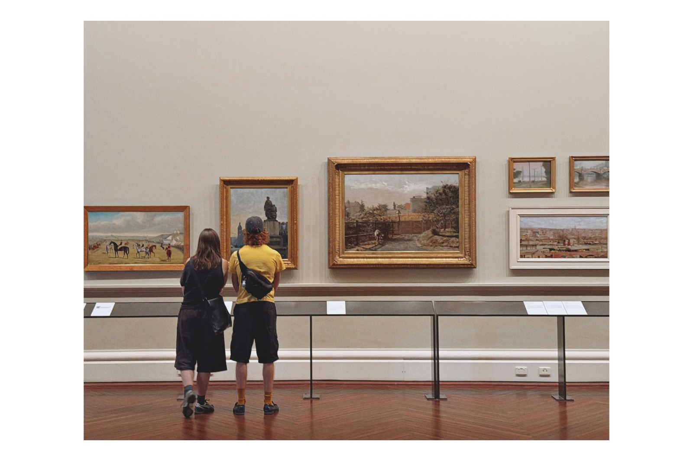
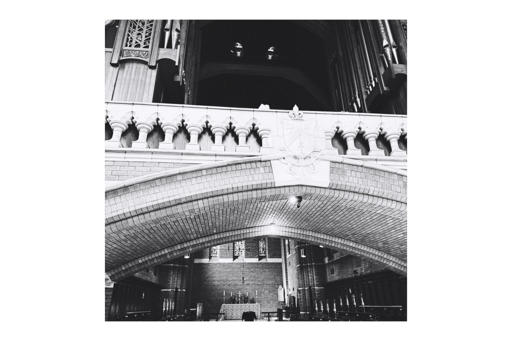
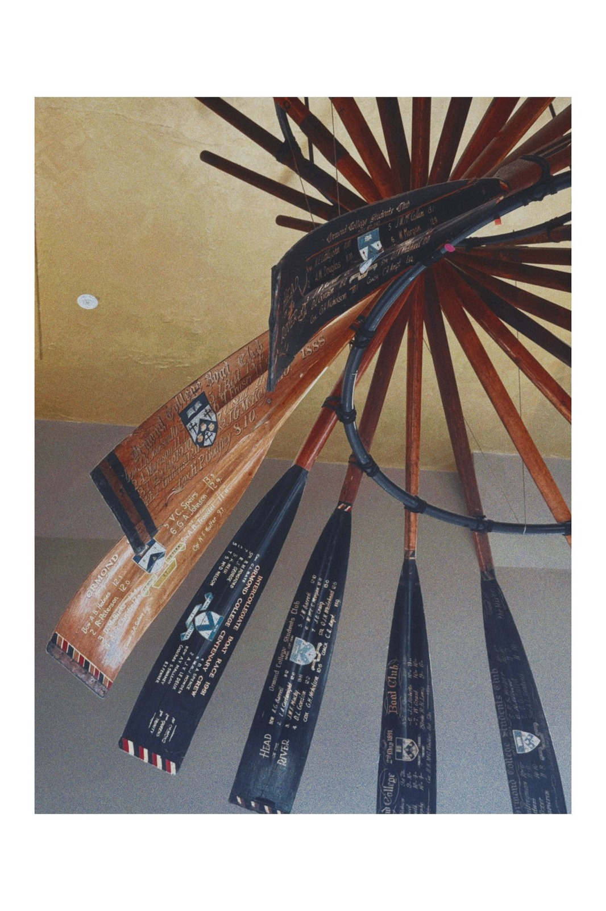
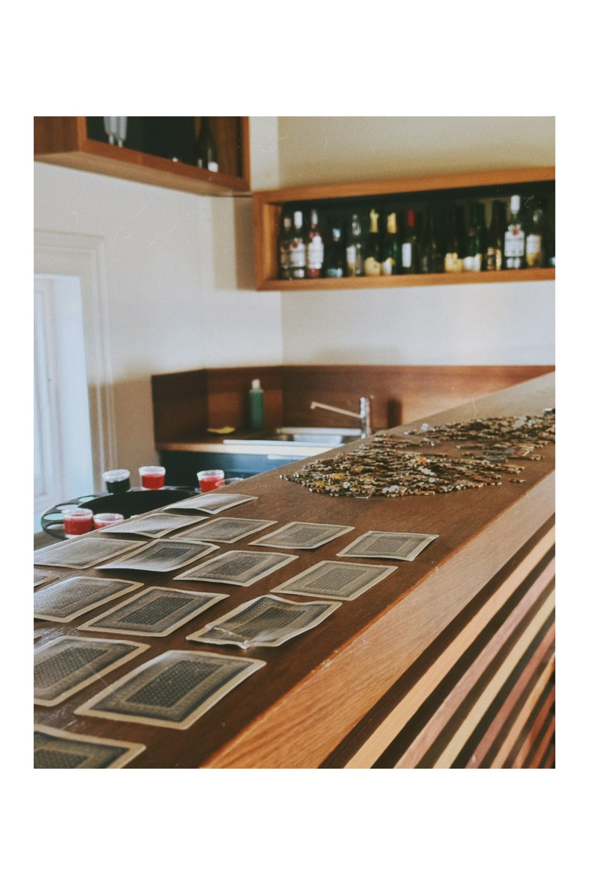
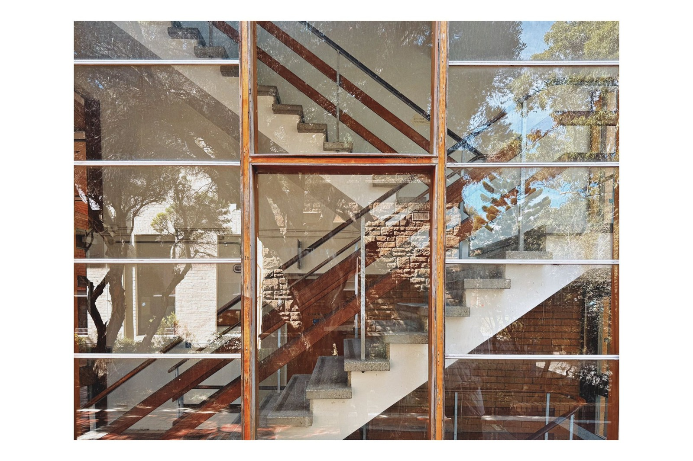
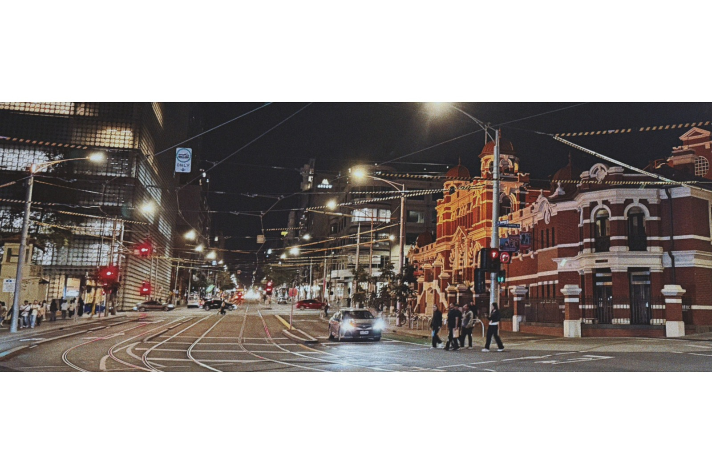
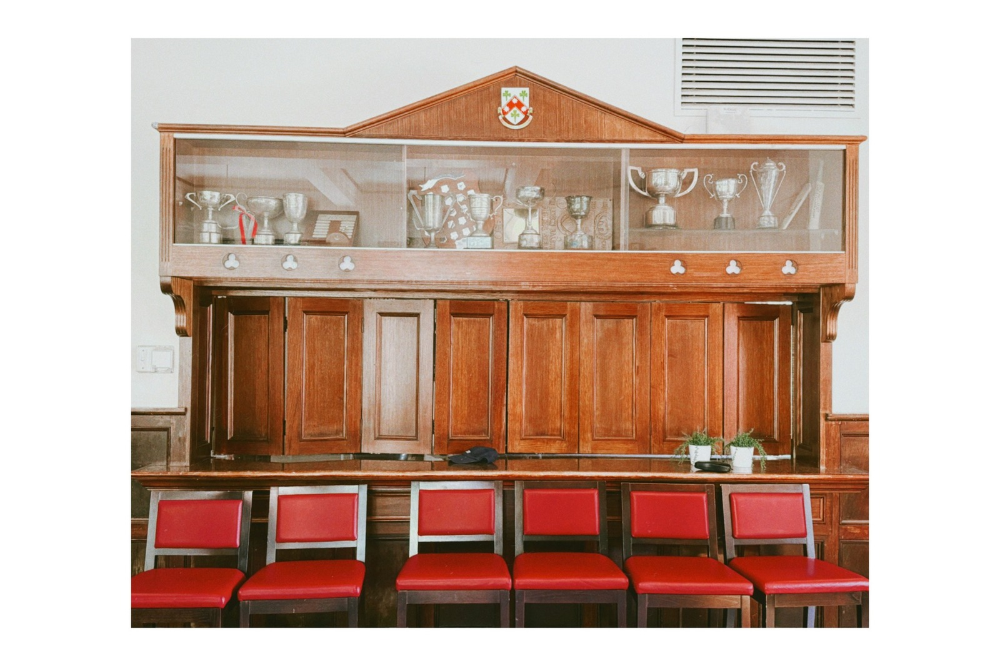
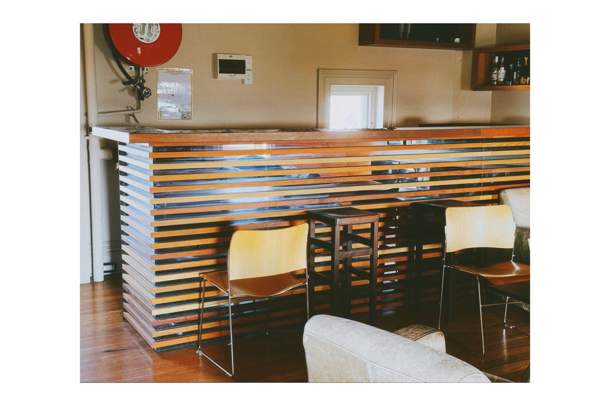

<a href="https://github.com/MoonMere/phone-photos/blob/main/README.zh-CN.md"><kbd>中文</kbd></a>

# Phone Photos

These are photos I took on my phone, mostly in Melbourne.

  
  

  
  

  
  

  
  

  
  

All photos belong to me, Siyuan Hou. Please ask before using them anywhere else.
